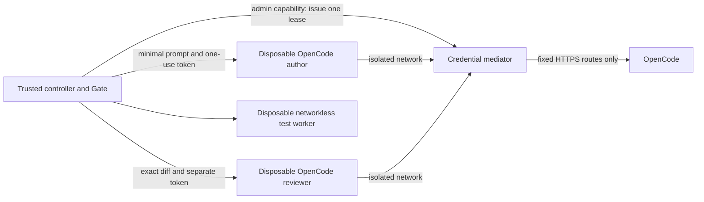

# Isolated OpenCode inference

The trusted native controller launches author/reviewer containers only while they have
work. They are not idle agents that merely make a Docker dashboard look busy. The Gate,
model router, deterministic probes and controller retain their separate responsibilities.



OpenCode 1.19.4 and its platform binaries are version/integrity locked. The four allowed
model records come from the recorded public catalog snapshot under `infra/opencode/`.
There is no runtime catalog fetch, new provider, paid top-up or implicit billing authority.
Catalog-based CLI costs are reported estimates, not an invoice or provider billing cap.

Build the images and prepare/start local state:

```sh
.venv/bin/python scripts/prepare_stack.py
.venv/bin/python scripts/build_agents.py
.venv/bin/python scripts/stack.py up
```

Without an explicit credential mount, only the anonymous OpenCode route is configured.
The **routing example is expired**, so this does not authorize an inference call. An
operator can explicitly mount their existing owner-only OpenCode API credential store:

```sh
.venv/bin/python scripts/stack.py --provider-auth /absolute/operator/path/auth.json up
```

The stack helper validates file metadata without reading or printing its contents.
Only the trusted gateway application reads it. It never copies the credential store,
mounts it in an agent, forwards a worker's Authorization header, or returns a key. Repeat
the explicit mount option when updating that service. `docker compose up` alone uses the
default UID 1000; use the helper to match your non-root operator UID/GID for private files.

The controller's gateway administration token is a separate owner-only local secret.
An agent receives a random expiring single-use token whose hash alone is stored. Its
lease binds the attempt ID, role, exact admitted prompt digest, model, expiry (at most
180 seconds) and output bound (at most 16384 tokens). SQLite consumes it before dispatch.
Unknown/consumed requests are never replayed after timeout, crash or gateway restart.
Known provider refusals keep their original HTTP status and response digest. The role
receives a terminal local error; the adapter stops a CLI that internally retries quota
messages. Only the router can create a different authorized fallback attempt.

The mediator accepts a single text-only user message and the CLI system message, then
rebuilds a short trusted system instruction plus the exact admitted prompt. It discards
the generic CLI environment message and all unrelated request fields. Tools, attachments,
alternate completions, altered prompts/models and arbitrary routes are refused. Its
HTTPS client uses OS certificate validation, a fixed `opencode.ai` host/path allowlist,
bounded request/response/deadlines, and no redirects or retry. Stream completion and
finite nonnegative integer token usage are required; CLI usage must match the mediator.

Each role has no mounts, UID 65532, no capabilities, no-new-privileges, read-only root,
1 GiB RAM/no swap, one CPU, 128 PIDs, 256 MiB noexec tmpfs, 4 MiB per file, 256 open files,
bounded 2 MiB combined process output and at most 180 seconds. Daemon logging is disabled.
The controller always removes its container and revokes an unused lease. A consumed or
unknown lease cannot be refunded by revoke. Cleanup uncertainty is an explicit failure.

The role network uses `internal` **and** `gateway_mode_ipv4=isolated`: `internal` alone
can still reach host gateway services. External DNS is directed to the role's unused
loopback resolver while Docker service discovery still resolves the gateway. The real
container qualification checks both host/public network and external DNS refusal.

```sh
AEION_INFERENCE_TESTS=1 .venv/bin/python -m pytest -q tests/test_docker_inference.py
```

These four tests execute the real CLI, separate author/reviewer containers, mediated
usage, resource/privilege/filesystem/network/DNS/admin refusal, timeout removal and quota
termination. Their upstream responses and token counts are explicitly **controlled**;
they are not provider-backed independent model work. Unit tests also cover concurrent
lease consumption, restart, missing usage, key reflection, strict schema and fixed egress.

Canonical admissions now bind that lease to a pre-call reservation in the Gate ledger;
unknown/mismatched usage blocks acceptance and further calls. See [accounting](accounting.md)
for the conservative envelope and remaining reconciliation limits. The
explicit native inference setting is legacy diagnostics, not an alternative qualified
sandbox. These controls do not prove kernel security, upstream model independence,
arbitrary code correctness or production readiness.
